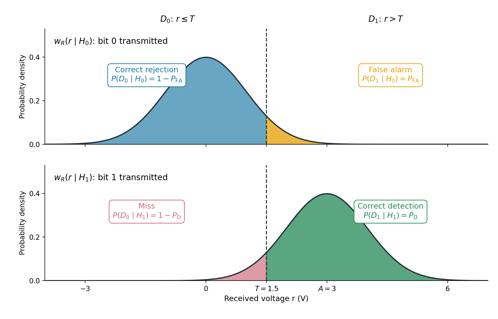

# Objective

Simulate transmission of bits using two voltage levels with additive noise,
make receiver decisions by thresholding, and
measure detections and false alarms. Choose a maximum-likelihood threshold
and plot an ROC curve.

# Theoretical aspects

## Binary decisions by thresholding

A transmitter may represent each bit by a constant voltage level:

- bit 0: $s=0$ V; (or some other value)
- bit 1: $s=A$ V, where $A>0$.

The signal is corrupted by additive noise.
The receiver takes one sample per transmitted bit to make a decision.
The received voltage is:

$$
r=s+n,
$$ {#eq-received-voltage}

where $n$ is additive noise. The two hypotheses describe what was transmitted:

- $H_0$: bit 0 was transmitted ($s=0$ V);
- $H_1$: bit 1 was transmitted ($s=A$ V).

The receiver does not know the transmitted bit. It compares $r$ with a
threshold $T$ and makes one of two decisions:

$$
D_1\text{ (decide bit 1) if }r>T;\qquad
D_0\text{ (decide bit 0) if }r\le T.
$$ {#eq-threshold-rule}

Hypotheses are the true transmitted bit.
Decisions are the receiver's output. Noise can cause the decision to be wrong.

## Four possible outcomes

- **Correct rejection** ($D_0 \mid H_0$): receiver decides 0 ($D_0$) when bit 0 was transmitted ($H_0$).
- **False alarm** ($D_1 \mid H_0$): receiver decides 1 ($D_1$) when bit 0 was transmitted ($H_0$).
- **Miss** ($D_0 \mid H_1$): receiver decides 0 ($D_0$) when bit 1 was transmitted ($H_1$).
- **Correct detection** ($D_1 \mid H_1$): receiver decides 1 ($D_1$) when bit 1 was transmitted ($H_1$).

We can compute the (conditional) probabilities of these four outcomes, based on the distributions $w(r\mid H_0)$ and $w(r\mid H_1)$
in @fig-conditional-probabilities. We know how to compute such probabilities.

- Probability of correct rejection: $P_{\mathrm{CR}}=P(D_0\mid H_0)$.
- Probability of false alarm: $P_{\mathrm{FA}}=P(D_1\mid H_0)$.
- Probability of miss: $P_{\mathrm{M}}=P(D_0\mid H_1)$.
- Probability of correct detection: $P_{\mathrm{D}}=P(D_1\mid H_1)$.

{#fig-conditional-probabilities width=95% fig-align="center"}

In practice, these values can be estimated from a finite number of observations, by counting.

$$
\widehat{P}_{\mathrm{FA}} = \frac{\text{number of false alarms}}{\text{number of transmitted bit 0s}}
\qquad
\widehat{P}_{\mathrm{D}} = \frac{\text{number of correct detections}}{\text{number of transmitted bit 1s}}.
$$ {#eq-estimated-probabilities}

## Maximum likelihood criterion

How to choose the value of the threshold $T$, i.e. how to take a decision based on a received voltage $r$?

The **Maximum Likelihood (ML)** criterion chooses the hypothesis with the
larger density function at the received voltage $r$:

- take decision $D_1$ if $w_R(r\mid H_1)>w_R(r\mid H_0)$
- take decision $D_0$ if $w_R(r\mid H_1)\le w_R(r\mid H_0)$.

In our case, this means choosing the threshold $T$ at the intersection of the two densities, which is in the middle, as shown in @fig-conditional-probabilities.

$$
T_{\mathrm{ML}} = \frac{0 + A}{2}
$$


## Changing the threshold: the ROC curve

In general, choosing a threshold $T$ is a tradeoff between false alarms and correct detections.

The **receiver operating characteristic (ROC)** is a graphical representation obtained
by varying $T$ and plotting:

- horizontal axis: $P_{\mathrm{FA}}$;
- vertical axis: $P_{\mathrm{D}}$.

Each threshold value gives one point. The designer picks the threshold that meets the requirements.

The ROC curve indicates how well the two hypotheses can be separated across
thresholds.

{#fig-typical-roc width=80% fig-align="center"}


## Matlab tools

### Generating random bits with chosen probabilities

Use `rand(1,N)` to generate `N` uniform samples between 0 and 1. Comparing
each sample with 0.5 produces random bits with equal probabilities:

```matlab
N = 20000;
bits = rand(1,N) > 0.5;
```

To change the proportions, adapt the comparison threshold. For example,
to obtain approximately **30% zeros and 70% ones**:

```matlab
bits = rand(1,N) > 0.3;
```

Samples at or below 0.3 become 0; samples above 0.3 become 1. Since `rand()`
is uniform, the probabilities are $P(0)=0.3$ and $P(1)=0.7$.

More generally, `rand(1,N) > p0` produces zeros with probability `p0` and
ones with probability `1-p0`.


### Transmitted and received voltages

Multiply the bit vector by $A$, or use similar methods, to obtain the transmitted voltages.

Use `randn()` as in Lab 3 to generate independent Gaussian noise and add it to
the transmitted voltages to obtain the received vector `r`.

We can separate received samples according to the **transmitted**
bits, not the receiver's decisions, using logical indexing.

```matlab
r0 = r(bits == 0);
r1 = r(bits == 1);
```

Reminder: `==` tests equality element by element, while `=` assigns a value to a variable.

### Varying the threshold for the ROC

To vary the threshold, create a vector such as `thresholds = -4:0.05:7`.
Preallocate result vectors with `zeros(size(thresholds))`, then use a `for`
loop to fill one entry per threshold. Plot the ROC with `plot(pFA,pD)`.

## Summary: functions and notation you should know

<style>
table td, table th { border-bottom: 1px solid #ddd; }
</style>

| Signature or notation | Example | Description |
|---|---|---|
| `rand(1,N) > p0` | `bits = rand(1,N) > 0.3` | Random bits: probability `p0` of 0 and `1-p0` of 1 |
| `A*bits` | `s = 3*bits` | Map bits to transmitted voltage levels 0 and $A$ |
| `r(bits == 0)` | `r0 = r(bits == 0)` | Select received samples whose transmitted bit was 0 |
| `mu + sigma*randn(1,N)` | `3 + randn(1,10000)` | Normal samples with mean `mu` and standard deviation `sigma` |
| `r > T` | `decision = r > 1.5` | Logical decisions: 1 for $D_1$, 0 for $D_0$ |
| `sum(condition)` | `sum(r0 > T)` | Count observations satisfying a condition |
| `numel(x)` | `numel(r0)` | Number of observations in a vector |
| `hold on`, `hold off`, `legend(...)` | `legend('Bit 0 transmitted','Bit 1 transmitted')` | Overlay plots and identify them |
| `a:step:b` | `-4:0.05:7` | Candidate thresholds with a fixed step |
| `zeros(size(v))` | `pFA = zeros(size(thresholds))` | Preallocate a vector with the same dimensions as `v` |
| `for k = 1:numel(v)` | `T = thresholds(k)` inside the loop | Visit each candidate by index |
| `plot(x,y)` | `plot(pFA,pD)` | Plot detection probability against false-alarm probability |

```{=latex}
\newpage
```

# Theoretical exercise {#sec-theoretical-exercise}

A transmitter sends bit 0 as 0 V and bit 1 as 3 V. The received sample is
$r=s+n$, where the noise has the normal distribution $\mathcal{N}(0,1)$
with voltages expressed in volts. The receiver decides $D_1$ if $r>T$,
and $D_0$ otherwise.

1. Compute the theoretical probabilities of false alarm and correct detection:

   a. Draw the distribution of $r$ under each hypothesis, $w(r|H_0)$ and $w(r|H_1)$.

   b. What is the value of $T$ for the Maximum Likelihood (ML) decision rule?

   c. Compute the false-alarm probability $P_{\mathrm{FA}}$ and the detection probability $P_{\mathrm{D}}$ for the ML threshold.

# Matlab exercises

Write your commands in a script or live script. Label figures and record your
numerical results and short explanations in comments. Use the same generated
vectors throughout Exercises 1–3; do not generate new received samples inside the
threshold loop.

1. Simulate transmission using two voltage levels:

   Use $A=3$ V. The channel adds independent Gaussian noise with mean 0 V
   and standard deviation 1 V to each transmitted voltage. Thus, received
   samples follow $\mathcal{N}(0,1)$ under $H_0$ and $\mathcal{N}(3,1)$ under
   $H_1$, with voltages expressed in volts. Each sample leads to one bit
   decision.

   a. Generate a row vector `bits` of 20000 random bits 0 and 1, with equal probabilities.
      Do this by calling `rand()` and comparing with a suitable threshold.

   c. Transform `bits` to a vector `s` of transmitted voltages, using 0 V for bit 0
      and 3 V for bit 1.

   d. Generate a noise vector of the same size, with the normal distribution $\mathcal{N}(0,1)$,
      and create a received vector `r = s + n`.

   e. Run the code below to estimate the two conditional densities. Can a threshold
      separate all received samples correctly?

      ```matlab
      % Select received samples according to the transmitted bit
      r0 = r(bits == 0);  % What does this line do?
      r1 = r(bits == 1);  % What does this line do?

      % Use the same bin boundaries for both histograms
      edges = -4:0.25:7;
      figure
      histogram(r0, edges, 'Normalization', 'pdf', ...
          'FaceColor', [0 0.45 0.74], 'FaceAlpha', 0.5)
      hold on
      histogram(r1, edges, 'Normalization', 'pdf', ...
          'FaceColor', [0.85 0.33 0.10], 'FaceAlpha', 0.5)
      hold off
      xlabel('Received voltage (V)')
      ylabel('Estimated probability density')
      legend('Bit 0 transmitted', 'Bit 1 transmitted')
      ```

   f. From the histograms, choose an appropriate threshold $T$ to separate the two distributions.
      What happens to false alarms and misses when the threshold increases? What about when it decreases?

2. Evaluate individual thresholds:

   a. Set `T = 1.5`. Compute the vector of decisions `d` by comparing the
      values in `r` with the threshold. Each element of `d` should be 1
      ($D_1$) if the received voltage is greater than `T`, and 0 ($D_0$)
      otherwise. The vectors `bits`, `r`, and `d` must all have the same size.

   b. Compare `d` with the transmitted vector `bits` and count the four
      possible outcomes:

      - false alarms: the transmitted bit is 0, but the decision is 1;
      - correct rejections: the transmitted bit is 0 and the decision is 0;
      - correct detections: the transmitted bit is 1 and the decision is 1;
      - misses: the transmitted bit is 1, but the decision is 0.

      Use `==` to test equality, `&` to combine two logical conditions
      element by element, and `sum()` to count the positions satisfying
      both conditions. Put parentheses around each comparison.

   c. Count the transmitted 0s and 1s, storing the counts in `N0` and `N1`.
      Verify that false alarms plus correct rejections equal `N0`, and
      correct detections plus misses equal `N1`.

   d. Estimate the probability of false alarm `pFA` by dividing the counts of false alarms by `N0`. Estimate
      `pD` by dividing the correct detection count by `N1`, and the miss probability by
      dividing the miss count by `N1`. Verify that the detection and miss
      probabilities add up to 1.

      For `T = 1.5`, compare `pFA` and `pD` with the theoretical results
      from the [theoretical exercise](#sec-theoretical-exercise). Why are the estimates not exactly equal to theory?

   e. Calculate the total number of errors as false alarms plus misses.
      Check it by counting the positions where `d` differs from `bits`,
      using `~=` (not equal).

   f. Repeat for `T = 1` and `T = 2`, using the same `bits` and `r`.
      Record a small table with one row per threshold and columns for
      `T`, `pFA`, `pD`, and the total error count. Compare with your
      prediction from Exercise 1.

3. Draw the ROC:

   a. Create a vector `thresholds` of candidate thresholds from -4 to 7 in steps of 0.05.

   b. Complete the template below to calculate `pFA` and `pD` for each threshold.
      Replace each `...` with the appropriate expression,
      using the counting method from Exercise 2. Do not generate new noise
      inside the loop.

      ```matlab
      pFA = zeros(size(thresholds));
      pD = zeros(size(thresholds));

      for k = 1:numel(thresholds)
          T = thresholds(k);

          % Compute decisions for the received samples
          d = ...;

          % Compare decisions with transmitted bits and count outcomes
          falseAlarms = ...;
          correctDetections = ...;

          % Divide by the number of samples for the corresponding true bit
          pFA(k) = ...;
          pD(k) = ...;
      end
      ```

   c. Plot the vector `pD` against `pFA`.

# Final questions

1. If every received voltage increases by 10 V, how should the threshold change to keep
   every decision unchanged? Would the ROC change?
2. Can a detector have no false alarms in 10000 simulated samples for transmitted bit 0
   even though its true false-alarm probability is positive?
3. A receiver always outputs $D_0$ (bit 0). What are its detection and
   false-alarm probabilities? Where is its point on the ROC? What if it
   always outputs $D_1$ instead?
