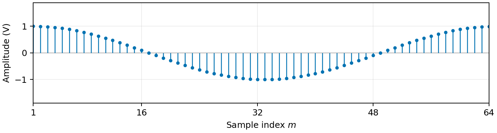
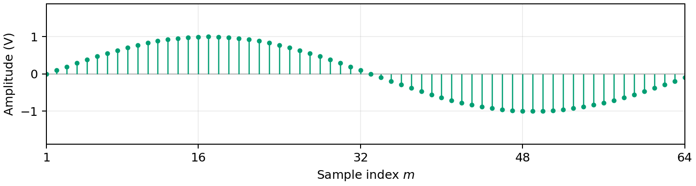
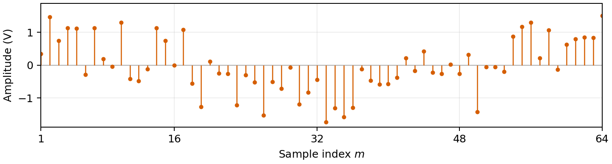

# Objective

Detect a transmitted bit represented by a waveform rather than a single
voltage sample. Implement a minimum-distance receiver, obtain an equivalent
inner-product receiver, and compare their decisions and error rates in noise.

# Theoretical aspects

## From one sample to a waveform

In Lab 6, the receiver made a decision from one sample of the received voltage.

Now, we consider that the receiver takes **multiple samples** from the received waveform.
Therefore, we now work with **vectors** rather than single values:

The receiver observes a noisy vector:
$$
\mathbf{r}=\mathbf{s} + \mathbf{n},\qquad b\in\{0,1\},
$$ {#eq-received-waveform}

where the vector $\mathbf{s}$ is one of two known reference vectors,
containing the samples from the two candidate waveforms:

- $H_0$: the vector $\mathbf{s}_0$ with the samples from $s_0(t)$ (bit 0).,
- $H_1$: the vector $\mathbf{s}_1$ with the samples from $s_1(t)$ (bit 1).

The noise samples are independent and have distribution
$\mathcal{N}(0,\sigma^2)$, with the same variance at every sample position
and under both hypotheses.

Like before, the receiver must make a binary **decision** about
what bit it thinks was received.

For example, let $s_0(t)$ be a cosine, and $s_1(t)$ be a sine, and
the received samples are in the vector $\mathbf{r}$:

$$
\begin{aligned}
\mathbf{s}_0 &= [1.00,\;1.00,\;0.98,\;0.96,\;\ldots,\;0.98,\;1.00],\\
\mathbf{s}_1 &= [0.00,\;0.10,\;0.20,\;0.29,\;\ldots,\;-0.20,\;-0.10],\\
\mathbf{r} &= [0.34,\;1.46,\;0.75,\;1.13,\;\ldots,\;0.83,\;1.51].
\end{aligned}
$$ {#eq-example-sample-vectors}

::: {#fig-waveform-example layout-ncol=1}
{#fig-example-cosine width=95%}

{#fig-example-sine width=95%}

{#fig-example-noisy-cosine width=95%}

Two candidate bit waveforms and a noisy observation when bit 0 is sent.
Each vector contains 64 samples over one bit interval.
The receiver must decide which bit was sent, based on the received vector $\mathbf{r}$.
:::

How do we decide if the received vector $\mathbf{r}$ is bit 0 or bit 1?

When the noise is Gaussian, the we have two equivalent ways to make the decision:

1. **Minimum Euclidean distance**
2. **Maximum inner product** (i.e. matched filtering),


## Minimum Euclidean distance

Compute the Euclidean distance from vector $\mathbf{r}$ to each the vectors $\mathbf{s}_0$ and $\mathbf{s}_1$,
and choose the smallest distance.

Euclidean distance between two vectors $\mathbf{a}$ and $\mathbf{b}$ is the square root of the sum of squared differences:
$$
d(\mathbf{a},\mathbf{b})=
\sqrt{\sum_{i=1}^{L}(a_i-b_i)^2}.
$$ {#eq-euclidean-distance}

The smallest distance wins:

$$
\newcommand{\grtlessH}{\underset{{H_0}}{\overset{H_{1}}{\gtrless}}}
d(\mathbf{r},\mathbf{s}_0)^2 \grtlessH d(\mathbf{r},\mathbf{s}_1)^2 + 2 \sigma^2 \ln(K) \qquad \qquad
K = \begin{cases}
1, & \text{ML criterion} \\
\frac{P_0}{P_1}, & \text{MPE criterion} \\
\frac{(C_{10}-C_{00})P(H_0)}{(C_{01}-C_{11})P(H_1)}, & \text{MR criterion} \\
\end{cases}
$$ {#eq-squared-distance}

For the **Maximum Likelihood (ML)** criterion, $K=1$, and the decision rule simplifies to
choosing the smallest distance:

$$
\newcommand{\grtlessH}{\underset{{H_0}}{\overset{H_{1}}{\gtrless}}}
d(\mathbf{r},\mathbf{s}_0) \grtlessH d(\mathbf{r},\mathbf{s}_1)
$$ {#eq-distance-decision}


## Maximum inner products

Compute the inner products between the received vector $\mathbf{r}$ and each of the reference vectors $\mathbf{s}_0$ and $\mathbf{s}_1$,
and choose the largest value (with some added energy correction terms).

For two real vectors $\mathbf{a}$ and $\mathbf{b}$, the inner product is:

$$
\langle\mathbf{a},\mathbf{b}\rangle=\sum_{i=1}^{L}a_i b_i.
$$ {#eq-inner-product}

The general decision rule is:

$$
\langle \mathbf{r}, \mathbf{s}_1 \rangle - \frac{E_1}{2}
\underset{H_0}{\overset{H_1}{\gtrless}}
\langle \mathbf{r}, \mathbf{s}_0 \rangle - \frac{E_0}{2}
+ \sigma^2 \ln(K)
$$ {#eq-inner-product-decision-general}

where

$$
\begin{aligned}
E_0 &= \langle \mathbf{s}_0, \mathbf{s}_0 \rangle,
\qquad
E_1 = \langle \mathbf{s}_1, \mathbf{s}_1 \rangle,
\\[0.5em]
K &=
\begin{cases}
1, & \text{ML criterion}, \\
\dfrac{P_0}{P_1}, & \text{MPE criterion}, \\[0.5em]
\dfrac{(C_{10}-C_{00})P_0}{(C_{01}-C_{11})P_1},
& \text{MR criterion}.
\end{cases}
\end{aligned}
$$ {#eq-inner-product-decision-general-2}

If the two waveforms have **equal energy**, $E_0=E_1$, and when the Maximum Likelihood criterion is used,
the decision rule simplifies to:

$$
\langle \mathbf{r}, \mathbf{s}_1 \rangle
\underset{H_0}{\overset{H_1}{\gtrless}}
\langle \mathbf{r}, \mathbf{s}_0 \rangle.
$$ {#eq-inner-product-decision}


## Matlab tools

### Vector operations

For equal-length row vectors `a` and `b`:

```matlab
sum((a - b).^2)  % squared Euclidean distance. Use sqrt() if you want the actual distance.
sum(a .* b)      % inner product
sum(a.^2)        % discrete energy of a, inner product of `a` with itself
```

Use element-wise operators `.^` and `.*`.

Make sure the vectors `a` and `b` are both row vectors or both column vectors,
with same size.

## Creating zeros and ones

```matlab
ones(1,L)   % row vector of L ones
zeros(1,L)  % row vector of L zeros
```

## Concatenating objects

```matlab
a = [1 2 3 4 5]
b = [6 7 8 9 10]
[a b]  % join objects a and b horizontally
[a; b]  % join objects a and b vertically
```

## Summary: functions and notation you should know

<style>
table td, table th { border-bottom: 1px solid #ddd; }
</style>

| Signature or notation | Example | Description |
|---|---|---|
| `ones(1,L)`, `zeros(1,L)` | `ones(1,8)` | Constant row vectors |
| `[a b]` | `[ones(1,8) zeros(1,8)]` | Join row vectors end to end |
| `sum((a-b).^2)` | `sum((r-s0).^2)` | Squared Euclidean distance |
| `sum(a.*b)` | `sum(r.*s0)` | Inner product of real row vectors |
| `sum(a.^2)` | `sum(s0.^2)` | Discrete waveform energy |
| `sigma*randn(1,L)` | `2*randn(1,16)` | Independent zero-mean Gaussian noise samples |
| `rand(1,N) > 0.5` | `bits = rand(1,10000) > 0.5` | Equiprobable random bits |
| `if ... elseif ... else ... end` | See the example templates | `if` statement with multiple conditions |
| `for k = 1:N` | `for k = 1:N` | for loop. Must end with `end` |
| `plot(x,y)`, `hold on`, `legend(...)` | `plot(sigmaValues,errorRates)` | Plot and identify observations or results |

```{=latex}
\newpage
```

# Exercises

1. **Prepare data**

   a. Create two vectors of length `L = 16` to represent the two candidate waveforms for one bit interval,
   according to Manchester encoding:

      $\mathbf{s}_0 =$ 8 ones followed by 8 zeros

      $\mathbf{s}_1 =$ 8 zeros followed by 8 ones.

      Multiply the vectors by $A = 5$ to increase the amplitude.

   b. Plot the two vectors.

   c. Compute the energies $E_0$ and $E_1$ of the two reference waveforms.

   d. Generate one received row vector `r` by adding independent Gaussian noise with mean 0 V and standard deviation `sigma = 1.5` V to the transmitted waveform (choose either `s0` or `s1`). Plot `r` and the two references together.


2. **Simulate transmission and count the four outcomes.**

   Define `N = 1000`, and `sigma = 1.5`.

   Write a `for` loop to simulate the transmission of `N` bits, one bit at a time, and count the four possible outcomes (correct rejection, false alarm, miss, and correct detection).

   a. Before the loop, initialize counters to zero:
      `countCR`, `countFA`, `countMiss`, and `countDetection`
      and also `N0` and `N1` (to count the number of transmitted bits 0 and 1, respectively).

   b. Write a for loop that iterates `k` from 1 to `N`. In each iteration:

      - Generate one random bit value `bit`, with equal probabilities for 0 and 1.
        Hint: compare one value from `rand()` with 0.5.

      - Increment `N0` or `N1`, the counter for the number of transmitted bits 0 or 1, respectively.
        Hint: use an `if` statement; don't use `++` (Matlab does not support it).

      - Define `s` as `s0` or `s1` according to that bit. Use an `if` statement.

      - Generate a Gaussian noise vector of same size, with mean 0 and standard deviation `sigma`, and add it to `s` to obtain the received vector `r`.

      - Compute the squared distances from `r` to the `s0` and `s1`, and decide which bit was received.

        ```matlab
        dist0 = ...
        dist1 = ...
        if ...
            decision = 0;
         else
            decision = 1;
         end
         ```

      - Compare the transmitted bit and the decided bit, and increment the appropriate counter according to the scenario,
        Hint: use `if ... elseif ... else ... end`

        ```matlab
        if ...
             ...
        elseif ...
             ...
        elseif ...
             ...
        else
             ...
        end
        ```

   d. Estimate the four conditional probabilities, by dividing the counts by the number of transmitted bits of each type.

   e. Compute the total number of errors and the total probability of error.

3. **Add the inner-product decision rule**

   Add the inner-product decision rule to the simulation, and let the result be `decision2`.

   Verify that `decision2` is always equal to `decision`.
      Hint: use `assert()` function and check for equality.


4. **Effect of noise, amplitude, signals**

   a. Try different values of the amplitude $A$ (e.g., 1, 2, 5, 10). How does the error probability change? Explain why.

   b. Leave $A = 5$, and try different values of the noise standard deviation $\sigma$ (e.g., 0.5, 1, 1.5, 2, 3). How does the error probability change? Explain why.

   c. Leave $A = 5$ and $\sigma = 1.5$, but try different waveforms. How does the error probability change?

      - longer waveforms (e.g., 32 samples instead of 16), using the same encoding scheme (ones and zeros)
      - a cosine and a sine, with the same amplitude and number of samples

# Final questions

TBD
