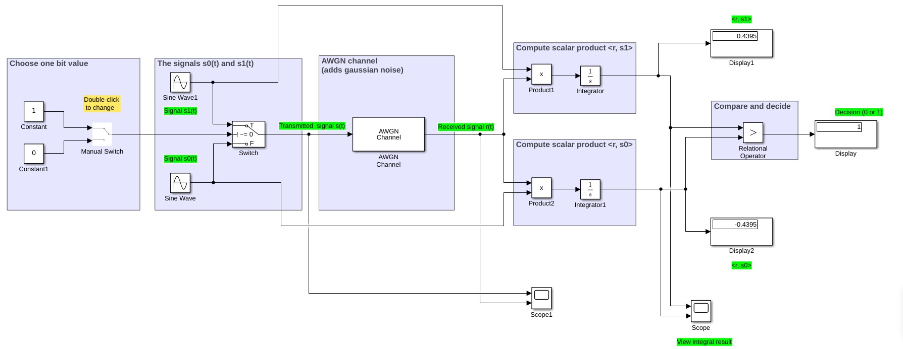
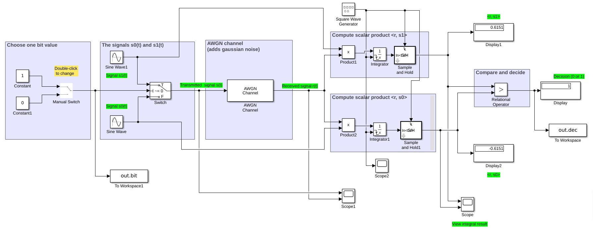
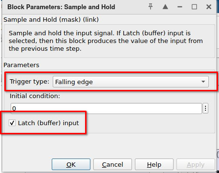
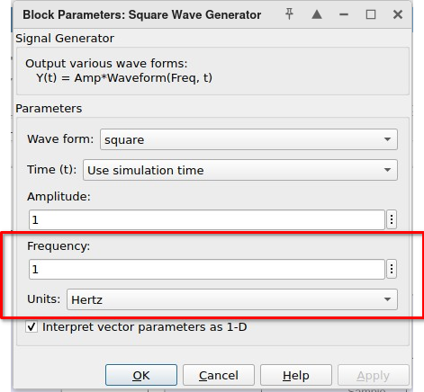
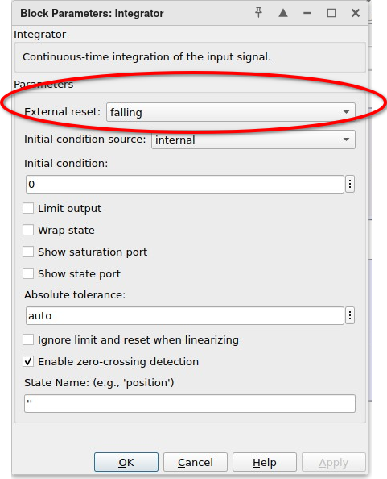
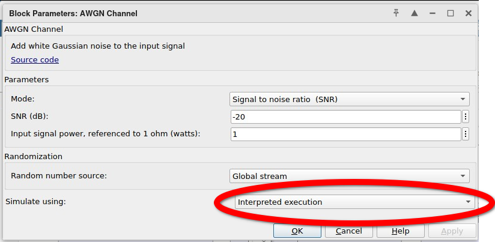
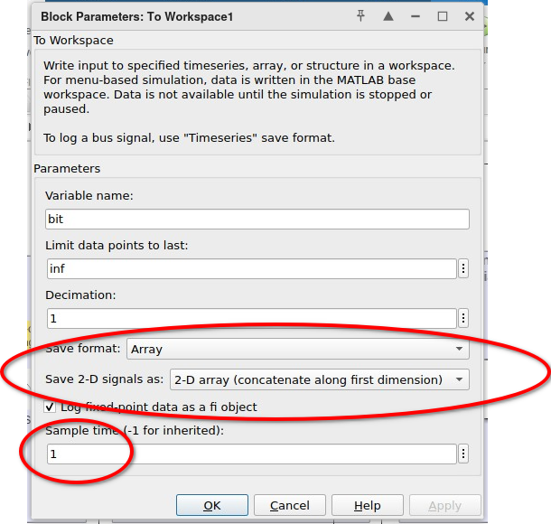

# Objective

Build a BPSK transmission and detection model in Simulink. First transmit one
bit and observe the waveforms and receiver scores. Then repeat the experiment
for 1000 transmitted bits and estimate the probabilities of correct detection and false alarm.

The model uses Simulink, Communications Toolbox (AWGN Channel), and
DSP System Toolbox (Sample and Hold).

# Theoretical aspects

## Two waveforms for two bits

**BPSK** (Binary Phase-Shift Keying) uses a cosine with phase $0$ to represent bit 1, and a cosine with phase $\pi$ to
represent bit 0. The transmitted waveforms are

$$
s_1(t)=\cos(2\pi f t),\qquad s_0(t)=-\cos(2\pi f t).
$$

The two waveforms have the same energy, since they are **opposites** of each other.

At the receiver, Maximum-Likelihood can be used to decide which bit was sent.

Assuming the noise is Gaussian, the decision rule is based on the scalar products
of the received waveform with the two reference waveforms:

$$
\langle \mathbf{r}, \mathbf{s}_1 \rangle
\underset{H_0}{\overset{H_1}{\gtrless}}
\langle \mathbf{r}, \mathbf{s}_0 \rangle.
$$ {#eq-inner-product-decision}

The larger scalar product wins the decision.

The two scalar products can be computed by multiplying the received waveform with each reference and integrating over the bit duration.

## Working in Simulink

We shall implement and simulate a BPSK transmission and detection model in Simulink.

### Blocks used in the models

| Block | Role and settings |
|---|---|
| Constant | Values `1` and `0`: the two possible transmitted bits |
| Manual Switch | Select which Constant supplies the bit |
| Sine Wave, for $s_1$ | Time based; amplitude `1`; bias `0`; frequency `2*pi` rad/s; phase `0`; sample time `0` |
| Sine Wave, for $s_0$ | Same settings, but amplitude `-1` |
| Switch | Three inputs: $s_1$ at the top, bit control in the middle, $s_0$ at the bottom; criterion `u2 ~= 0` |
| AWGN Channel | Add Gaussian noise; `Signal to noise ratio (SNR)` mode |
| Product | Two inputs, element-wise multiplication: received signal times one reference |
| Integrator | Initial condition `0`; integrate each Product output |
| Relational Operator | Operator `>`; compare two values |
| Scope, Display | Show waveforms and values |
| Square Wave Generator | Model 2 only: generate recangular pulses |
| Sample and Hold | Model 2 only: capture and retain one value per bit |
| To Workspace | Model 2 only: export the bit and decision as arrays |

### General explanations

For simulation purposes, we consider each bit to last one second of simulation time.
For this reason, we set the frequency of the Sine Wave blocks to $f=1$ (i.e., $\omega = 2\pi$ rad/s, so that one period of the cosine is one second.
In practice, the frequency is much higher than one Hertz, and one bit consists of many periods of the carrier cosine.

<!-- For the run with ones, estimate the **probability of correct detection**:

$$
\widehat P_D=\frac{\text{number of decisions equal to 1 when bit 1 was sent}}
{\text{number of transmitted ones}}.
$$

For the separate run with zeros, estimate the **probability of false alarm**:

$$
\widehat P_{FA}=\frac{\text{number of decisions equal to 1 when bit 0 was sent}}
{\text{number of transmitted zeros}}.
$$ -->

<!-- Each denominator is 1000, not 2000. Correct detection is a conditional
probability, not the overall fraction of correctly recovered bits in both runs.
Use logical comparisons and `sum()` to count decisions, as in previous labs.

`double()` converts Boolean decisions to numeric zeros and ones.
`numel()` counts elements; `assert()` stops a script if a required check fails.
Save the first run's arrays in separate variables before starting the second
run, because the next simulation replaces `out`. -->

<!-- ### Summary: functions and notation you should know

<style>
table td, table th { border-bottom: 1px solid #ddd; }
</style>

| Tool or notation | Example | Meaning |
|---|---|---|
| Product followed by Integrator | $\int r(t)s_1(t)\,dt$ | Scalar-product receiver score |
| Relational Operator `>` | $z_1>z_0$ | Decision 1 when the first reference has the larger score |
| External reset | Integrator: `falling` | Restart integration at a bit boundary |
| Sample and Hold | Capture at a falling edge | Retain a score while integration restarts |
| To Workspace, Array | Variable name `dec` | Export a scalar signal as a column of values |
| `out.bit`, `out.dec` | `b = out.bit` | Access the two logged arrays |
| `a(2:end)` | Remove the initialization row | Keep decisions on completed bits |
| `double(a)` | `double(out.dec)` | Convert logical values to numeric values |
| `sum(condition)` | `sum(d == 1)` | Count entries satisfying a condition |
| `numel(a)`, `assert(condition)` | `assert(numel(d)==1000)` | Check that 1000 decisions were retained |
| $\widehat P_D$, $\widehat P_{FA}$ | Separate runs with ones and zeros | Two conditional probabilities | -->

```{=latex}
\newpage
```

# Exercises

1. **Transmit and detect one bit.**

   Implement the model in @fig-lab8-model1 and save it as `Lab8_OneBit.slx`.


   {#fig-lab8-model1 width=100%}

   a. Select bit 1 with the Manual Switch. Run the model for 1 second (set Stop Time to `1`).

      Identify and look at the following:

      - the transmitted and the received (noisy waveforms)
      - the result of the integrator blocks
      - the values of the two scalar products at the end of the run
      - the final decision value

   b. Run several times and watch how the noise changes the received waveform and scalar product values.

   c. Set the SNR to `-20` dB. Run the model 10 times for each bit value, and watch the decisions.

      How many false alarms and misses do you observe?

   d. Set the SNR to `-40` dB and repeat. Are false alarms and misses more common now?

2. **Implement the model for multiple bits.**

   Implement the model in @fig-lab8-model2 and save it as `Lab8_RepeatedBits.slx`.

   Start from a copy of the previous model, and do the changes explained below.

   {#fig-lab8-model2 width=100%}

   In this model, we will send and receive more than one bit.
   To achieve this, we need to sample the integrator values after each bit and hold them until the next bit is received.
   We also need to reset the integrators at the end of each bit, so that they start from zero for the next bit.
   In addition, we save the data to the workspace, for later analysis.

   Changes and updates needed to implement Model 2 based on Model 1:

   1. Add **Sample and Hold** blocks after each integrator output.

      Set the **Trigger type** to `Falling edge` and check the `Latch (buffer) input` box
      as illustrated in @fig-lab8-sample-settings.

   2. **Reset the integrators every second.**  To do this, set both Integrators' **External reset** to **falling**


   3. Add a **Square Wave Generator** block, and configure it as in @fig-lab8-square-settings.

      Connect it to the External Reset of both integrators, and to the Trigger of both Sample and Hold blocks.

      Now, the falling edge of the square signal will trigger the Sample and Hold blocks to capture the integrator values, and the integrators will reset to zero for the next bit.

   4. Add **To Workspace** blocks to send the bit values to the workspace.

      Configure the blocks as in @fig-lab8-workspace-settings.

   5. For the AWGN block, set **Simulate using: Interpreted execution**, as in @fig-lab8-awgn-settings.

   6. Set the **Stop Time** to `1000` seconds and the **SNR** to `-20` dB.

   ::: {#fig-lab8-model2-settings layout-ncol=2}

   {#fig-lab8-sample-settings width=100%}

   {#fig-lab8-square-settings width=100%}

   {#fig-lab8-integrator-settings width=100%}

   {#fig-lab8-awgn-settings width=100%}

   {#fig-lab8-workspace-settings width=100%}

   Block settings for Model 2.
   :::

3. **Transmit 1000 ones, then 1000 zeros.**

   a. Restore SNR to `-20` dB and set Stop Time to `1000`. Select bit 1 and
      run.

      The input and output arrays are saved in `out.bit` and `out.dec`. In Matlab, we can compute the probabilities of correct detection and misses as follows:

      ```matlab

      Compute the probabilities of correct detection and misses as follows:

      ```matlab
      b = out.bit(2:end);     % Skip first initialization value
      d = out.dec(2:end);     % Skip first initialization value

      p_cd = sum(d==1)/sum(b);  % Correct detection probability
      p_miss = sum(d==0)/sum(b); % Miss probability
      ```

   b. Select bit 0 and run for another 1000 seconds.

      Compute the probabilities of false alarm and correct rejection, using a similar approach.

   c. Change the SNR to `-10` dB and repeat the two 1000-bit runs. Compare the results with the previous ones.


