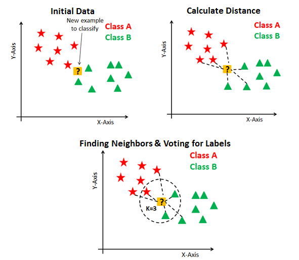

# Objective

Implement and use the k-NN algorithm to classify ECG signals. Evaluate the
classification with a confusion matrix and study the effects of noise and a DC offset.

The built-in k-NN functions used here require Statistics and Machine Learning Toolbox.

# Theoretical aspects

## ML decision with multiple samples in Gaussian noise

In a detection problem with additive, zero-mean Gaussian noise of the same
variance under both hypotheses, the Maximum Likelihood criterion comes down
to **choosing the smallest distance**.

$$
\providecommand{\grtlessH}{\underset{{H_0}}{\overset{H_{1}}{\gtrless}}}
d(\mathbf{r}, \mathbf{s}_0) \grtlessH d(\mathbf{r}, \mathbf{s}_1)
$$

With multiple samples, assuming the noise is stationary and the samples are independent,
the distance is the Euclidean distance:

1. We have vectors of samples: $\mathbf{r}, \mathbf{s}_0, \mathbf{s}_1$ (bold font = it is a vector)
2. The distance between any two vectors $\mathbf{a}$ and $\mathbf{b}$ is the **Euclidean distance**:
   $$
   d(\mathbf{a}, \mathbf{b}) = \sqrt{(a_1 - b_1)^2 + (a_2 - b_2)^2 + \cdots + (a_n - b_n)^2}
   $$
3. We use the same distance-based rule, with the Euclidean distance.

   The smallest distance wins.

## The k-NN algorithm

Suppose we have a set of **training signals** whose classes are known beforehand.
For example:

- 100 signals of class A (e.g. normal heartbeats)
- 100 signals of class B (e.g. heartbeats with one type of arrhythmia)
- maybe more classes

We have a new signal $\mathbf{x}$. We need to decide to which class it belongs (class A, or class B, etc.).

We can use **the k-NN algorithm**:

1. Compute the distances from $\mathbf{x}$ to all the signals in the training set
2. Choose the **closest $k$ neighbors** and take the **majority class** within these neighbors
   (majority voting). Decide that this is the class of $\mathbf{x}$.

The same principle applies when we have more than two classes
(choose the majority class).
In case of a tie, we can either choose randomly, or figure out a way to break the tie.

A visual illustration[^1] is below:



[^1]: Image from ["KNN Classification using Scikit-learn", Avinash Navlani](https://www.datacamp.com/community/tutorials/k-nearest-neighbor-classification-scikit-learn)

## Dataset organization

Usually, we have a large set of signals whose classes are known. The data is
randomly split into:

- a **training set**: used to find the neighbors and their votes;
- a **validation set** (optional): used to choose parameters such as $k$;
- a **test set**: used only to evaluate the final classifier on unseen signals.

For example, a split might use $70\%$ for training, $15\%$ for validation, and
$15\%$ for testing. Cross-validation is another way to choose $k$, using repeated
training/validation splits within the training set.

The provided data is already split into training and test sets. In this lab,
we compare several prescribed values of $k$ on the test set as an experiment;
choosing $k$ from those results would require a separate unseen test set for
an unbiased final evaluation.

## k-NN algorithm in Matlab

Matlab has several implementations of the k-NN algorithm available.

For our purposes we can use the function `knnsearch()`.

The call below finds the 10 nearest neighbors in X for each vector in Y,
and returns their row indices in `Idx` and their Euclidean distances in `D`.
`X` and `Y` contain the vectors in **rows**. Each row of `Idx` and `D` corresponds
to one query vector in `Y`; the 10 neighbors are ordered by increasing distance.

```matlab
[Idx, D] = knnsearch(X, Y, 'K', 10);   % find 10 nearest neighbors for vectors in Y
```

One can also use the `fitcknn()` function, which is tailored for classification.
`fitcknn()` creates the **classification model** object,
and then calling `predict()` with the model
will output the predicted class for one or more test vectors.

```matlab
Mdl = fitcknn(X,Y, 'NumNeighbors', 3);    % use 3 neighbors
label = predict(Mdl, test_data);
```
- `X` = training data, each row is a vector
- `Y` = classes of the training data, each value = class of corresponding vector
- `test_data` = test data, each row is a vector for which we predict the class

## Confusion matrix

A **confusion matrix** $A$ is used to check the performance of a classification model,
by comparing predicted labels with the ground truth:

$$
A_{ij}=\text{number of test signals of true class }c_i
\text{ predicted as class }c_j.
$$

Rows represent **true classes** and columns represent **predicted classes**.
For labels `0`, `1`, `2`, `3`, use a fixed order:

```matlab
A = confusionmat(true_labels, predicted_labels, 'Order', [0 1 2 3]);
```

The diagonal contains correct classifications.
The overall **classification accuracy** is the sum of the diagonal entries divided by the total number of test signals,
which means the fraction of test signals that were classified correctly.

## Data for this laboratory

In this laboratory we use ECG signal data from the
[MIT-BIH Arrhythmia Database](https://physionet.org/content/mitdb/1.0.0/).

![Sample ECG signal from the MIT-BIH Arrhythmia Database [^2]](img/MITBIH.png)

[^2]: Image from the [PhysioNet database page](https://archive.physionet.org/physiobank/database/mitdb/).

The excerpt contains **4 classes**, with **120 signals per class**: one class of
normal heartbeats and three classes of arrhythmic (abnormal) heartbeats.
These are heartbeat classes, not diagnoses of healthy or ill persons.

The signals have been segmented into individual heartbeats, resized to
**256 samples**, and aligned around the R peak.

The data is already split into two sets:

| File | Signals | Labels | Organization |
|---|---|---|---|
| `ECG_train.mat` | `train`, $256 \times 400$ | `train_labels`, $1 \times 400$ | 100 signals per class |
| `ECG_test.mat` | `test`, $256 \times 80$ | `test_labels`, $1 \times 80$ | 20 signals per class |

Class labels are `0`, `1`, `2`, and `3`. In both matrices, **each column is one signal**.
The corresponding entry in the label vector gives its class.

The training set is used to find the nearest neighbors and their votes,
when running the algorithm.
The test set and the test labels are used only to evaluate the classifier.
The test set and labels should never be used for any purposes other than evaluation.

To use `fitcknn()` or `knnsearch()`, transpose the signal matrices with `.'`
so that each signal becomes a **row**, because the functions expect input signals as rows.
For `fitcknn()`, also turn the training labels into a column with `train_labels(:)`.

## Summary: functions and notation you should know

| Function or notation | Meaning |
|---|---|
| `load('ECG_train.mat')` | Load `train` and `train_labels` into the Workspace; existing variables with these names are overwritten |
| `train(:,j)`, `train_labels(j)` | Signal in column `j` and its class |
| `find(train_labels == c)` | Indices of training signals in class `c` |
| `X.'`, `labels(:)` | Transpose a matrix; reshape labels into a column |
| `sqrt(sum((a-b).^2))` | Euclidean distance between two vectors |
| `[d, idx] = sort(distances)` | Sort distances in ascending order and return their original indices |
| `[Idx,D] = knnsearch(X,Y,'K',k)` | Find the nearest training rows in `X` for each query row in `Y` |
| `fitcknn(X,labels,'NumNeighbors',k)` | Create a k-NN model; the default distance is Euclidean |
| `predict(Mdl,Y)` | Predict one label per query row in `Y` |
| `confusionmat(truth,prediction,'Order',[0 1 2 3])` | Count classifications with a fixed class order |
| `sigma*randn(size(test))` | Independent zero-mean Gaussian noise of standard deviation `sigma`, with the same size as `test` |
| `test + b` | Add the same DC offset `b` to every sample |

# Exercises

1. **Explore the dataset.** Load `ECG_train.mat` and `ECG_test.mat`.

   a. Check the variable names and dimensions. Display 3 training signals from
      each class. What visual differences can you identify?

   b. Display the first signal from the test set. Try to determine visually
      which class it belongs to, without looking at its test label.

2. **Classify one signal manually.** Take the first test signal and classify it using k-NN
   with $k=5$.

   You can use `knnsearch()` to find the nearest neighbors,

   or do the calculations manually, using the steps below:

   - Compute its Euclidean distance to each of the 400 training signals.
     Store the distances in a vector of length 400.

   - Find the 5 smallest distances and the labels of the corresponding
     training signals.

   - Determine the predicted class (in words, not in code).
     Compare it with the true label `test_labels(1)`.

3. **Use the built-in classifier.**

   Use `fitcknn()` and `predict()` with $k=5$ to predict the class of the same
   test signal. Remember that these functions expect one signal per **row**.

   Compare the result with Exercise 2. They should be the same. If not, check your calculations.

4. **Compute the confusion matrix.**

   a. Use `fitcknn()` and `predict()` to classify all 80 test signals. Repeat
      for $k=1$, $k=5$, and $k=15$. Keep the training set unchanged.

   b. Compare each prediction vector with `test_labels(:)` and compute a
      $4 \times 4$ confusion matrix for each value of $k$.
      Check that every row in the confusion matrix sums to 20 and that all entries sum to 80.

   c. Compute the overall accuracy for each value of $k$. Which classes are
      most often confused?

5. **Add Gaussian noise.** Repeat Exercise 4 after adding independent,
   zero-mean Gaussian noise to the test signals.

   The point is to observe how the classification performance decreases with noise.

   a. Try noise standard deviations $\sigma=0.02$, $0.05$, and $0.1$.

      For each noise level, generate noise and add it to the original test signals.
      Then classify the noisy test signals with $k=1$, $k=5$, and $k=15$.

   b. Compare the confusion matrices and accuracies with the noiseless baseline.
      How does performance change? Keep the original training set unchanged.

6. **Add a DC offset.** Repeat Exercise 4 with a constant offset added to all
   test samples. Try $b=0.02$, $0.05$, and $0.1$.

   a. Start from the original test signals each time, with **no added noise**,
      and add the constant value $b$ to the test signals.
      Then classify the offset test signals with $k=1$, $k=5$, and $k=15$.

   b. Compare the confusion matrices and accuracies with the baseline.
      How does a DC offset affect the Euclidean distances and the classification?

# Final questions

1. What does the confusion matrix look like for perfect classification?
   What are its diagonal entries for this test set?

2. Can imbalanced classes (different numbers of training signals per class)
   create a problem for k-NN voting? Would overall accuracy alone be enough to
   evaluate a classifier on an imbalanced test set?
